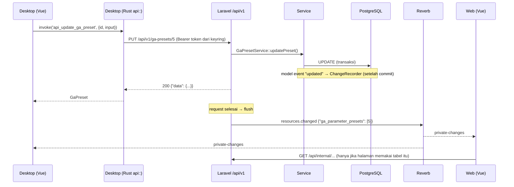
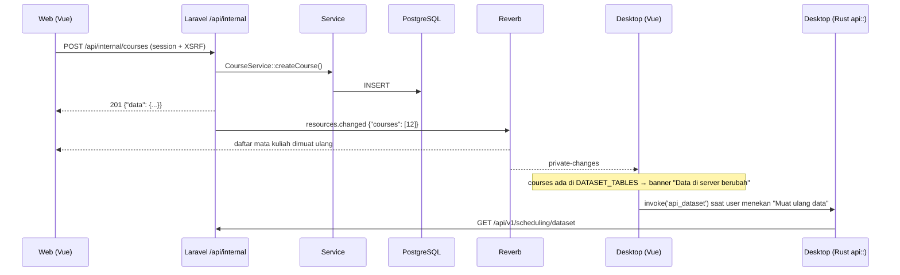

# Konvensi API: Web ↔ Desktop

Dokumen ini adalah kontrak antara backend Laravel, frontend web (Inertia + Vue), dan aplikasi desktop (Tauri). Baca dokumen ini sebelum menambah endpoint, tabel, atau halaman yang menampilkan data server.

Latar belakang dan keputusan desain: `docs/plans/api-architecture.md`.

---

## 1. Gambaran Umum

```
                  ┌───────────────── Laravel (apps/web) ─────────────────┐
Web (Vue)  ──session──▶ /api/internal/*  ─┐                              │
                  │                       ├─▶ FormRequest ─▶ Service ─▶ DB
Desktop (Rust) ─token─▶ /api/v1/*  ───────┘        (sama)     (sama)     │
                  │                                              │       │
                  │                    model event / record() ───┘       │
                  │                    ChangeRecorder ─ flush per request │
                  └──────────────────────────────┬────────────────────────┘
                                                 ▼
                                   Reverb: private-changes
                                   "resources.changed"
                                     │                 │
                                  Web (Echo)      Desktop (Echo + Rust auth)
```

- **Satu logika, dua pintu.** Controller `Api/V1/*` adalah subclass dari `Api/Internal/*`. Keduanya memakai FormRequest, Service, dan kelas `App\Data` yang sama. Logika bisnis hanya ada di `app/Services`.
- **Notifikasi, bukan data.** Event real-time hanya berisi nama tabel dan id. Klien mengambil ulang data lewat REST, sehingga policy tetap berlaku.

### 1.1 Alur desktop → web



### 1.2 Alur web → desktop



---

## 2. Struktur Folder

### 2.1 Laravel (`apps/web`)

```
app/
├── Data/<Domain>/                     # "API Resource": bentuk output yang sama untuk Inertia dan JSON
├── Events/Shared/ResourcesChanged.php # event broadcast "resources.changed"
├── Exceptions/Shared/                 # ApiException (kode error domain), ApiExceptionRenderer
├── Extensions/Models/Traits/
│   └── BroadcastsChanges.php          # dipasang di setiap model domain
├── Http/
│   ├── Controllers/Api/Internal/<Domain>/   # /api/internal/*, session
│   ├── Controllers/Api/V1/<Domain>/         # /api/v1/*, token; subclass dari Internal
│   ├── Controllers/Api/V1/Shared/BroadcastAuthController.php
│   ├── Controllers/Web/                     # halaman Inertia + alur session
│   └── Requests/<Domain>/                   # FormRequest, dipakai kedua jalur
├── Models/<Domain>/
└── Services/
    ├── <Domain>/                      # logika bisnis
    └── Shared/ChangeRecorder.php      # kumpulkan perubahan per request, broadcast sekali
routes/
├── api.php                            # grup internal dan v1, ditulis terpisah
├── channels.php                       # private-changes
└── web.php
```

### 2.2 Vue web (`apps/web/resources/js`)

```
lib/api.ts                      # axios ke /api/internal, toApiError(), fieldErrors()
lib/echo.ts                     # koneksi Reverb, satu langganan private-changes
composables/useResourceChanges.ts  # onResourcesChanged(tables, cb), tableOf(url)
composables/useApiList.ts       # usePaginatedList / useCollection, opsi `live`
types/models.ts                 # tipe yang mencerminkan App\Data
```

### 2.3 Tauri (`apps/desktop`)

```
src-tauri/
├── .cargo/config.toml          # SIMJADWAL_API_URL (base URL, dikompilasi ke binary)
└── src/
    ├── api/
    │   ├── mod.rs              # ApiClient: satu-satunya tempat HTTP
    │   ├── error.rs            # ApiError + enum ErrorCode
    │   ├── token.rs            # token di keyring OS
    │   ├── types.rs            # struct serde, cermin App\Data
    │   ├── auth.rs             # login, logout, me, broadcast_auth
    │   └── scheduling.rs       # dataset, faculties, ga-presets, upload run
    └── commands/api.rs         # #[tauri::command] tipis, hanya memanggil api::*
src/
├── lib/api/client.ts           # call() = invoke + ApiError
├── lib/api/*.ts                # satu fungsi per command
└── lib/echo.ts                 # onChanges(tables, cb), start/stopChanges
```

Aturan desktop: webview **tidak boleh** memakai `fetch` ke server, tidak pernah memegang token, dan tidak bisa mengubah base URL.

---

## 3. Penamaan

| Hal | Aturan | Contoh |
|---|---|---|
| Path | kebab-case, jamak | `/api/v1/teaching-assignments` |
| Parameter route | camelCase, nama model | `{studyProgram}`, `{gaPreset}` |
| Nama route | `api.<jalur>.<resource>.<aksi>` | `api.v1.ga-presets.update` |
| Field JSON (request dan response) | snake_case | `parallel_class_count`, `can_update` |
| Kelas output | `<Entitas>Data`, `<Entitas>SummaryData` | `CourseData` |
| Kelas input | `<Entitas>FormData`, `Store/Update<Entitas>Request` | `GaPresetFormData` |
| Kode error | SCREAMING_SNAKE_CASE, stabil | `DATASET_CHANGED` |
| Nama resource di event | nama tabel database | `course_lecturers`, `ga_parameter_presets` |
| Command Tauri | `api_<aksi>`, `auth_<aksi>`, `ga_<aksi>` | `api_update_ga_preset` |

---

## 4. Format Response

### 4.1 Sukses

| Jenis | Status | Body |
|---|---|---|
| Satu entitas | 200 / 201 | `{"data": {...}}` |
| Koleksi kecil (tanpa paginasi) | 200 | `{"data": [...]}` |
| Daftar berhalaman | 200 | `{"data": [...], "meta": {"pagination": {"page", "per_page", "total", "last_page"}}}` |
| Hapus | 204 | kosong |
| Channel auth (`broadcasting/auth`) | 200 | `{"auth": "..."}` (format Pusher, tanpa envelope) |

- `per_page` default 20, maksimum 100. Parameter halaman: `page`.
- Create mengembalikan 201. Upload run yang sudah pernah diterima (`client_run_id` sama) mengembalikan 200 dengan data yang tersimpan.
- Baris yang bisa diubah membawa `can_update` / `can_delete` dari policy. Klien menyembunyikan tombol berdasarkan field ini, bukan berdasarkan role.

### 4.2 Error

Semua error di `api/*` memakai satu bentuk:

```json
{ "message": "Pesan untuk ditampilkan ke user.", "code": "ERROR_CODE", "errors": { "field": ["..."] } }
```

`errors` hanya ada jika relevan (validasi, `references` pada `RESOURCE_IN_USE`). Di desktop, error yang sama sampai ke Vue sebagai `{status, code, message, errors}`, dengan `status: 0` jika tidak ada respons.

### 4.3 Kode error

| Status | `code` | Kapan |
|---|---|---|
| 401 | `UNAUTHENTICATED` | Tidak login, token dicabut, atau akun nonaktif. Desktop menghapus token dan kembali ke layar login. |
| 401 | `INVALID_CREDENTIALS` | Login gagal. Password salah dan akun nonaktif sengaja memberi error yang sama. |
| 403 | `FORBIDDEN` | Policy menolak. |
| 404 | `NOT_FOUND` | Data atau route tidak ada. |
| 405 | `METHOD_NOT_ALLOWED` | Method HTTP salah. Header `Allow` berisi method yang benar. |
| 409 | `RESOURCE_IN_USE` | Hapus ditolak karena masih dirujuk. `errors.references` berisi jumlah per jenis rujukan. |
| 409 | `INVALID_STATE` | Aksi tidak sesuai status data. |
| 409 | `CONSTRAINTS_LOCKED` | Constraint prodi sudah diajukan atau diterima. |
| 409 | `DATASET_CHANGED` | Hasil run dihitung dari data yang sudah berubah di server. |
| 409 | `IMPORT_PLAN_CHANGED` | Data berubah antara preview dan commit import. |
| 419 | `SESSION_EXPIRED` | Session web habis (hanya `/api/internal`). |
| 422 | `VALIDATION_FAILED` | Validasi gagal. `errors` berisi pesan per field. |
| 503 | `PDF_UNAVAILABLE` | Layanan PDF (Gotenberg) mati atau gagal saat export PDF. |
| 429 | `TOO_MANY_REQUESTS` | Rate limit. Header `Retry-After` tersedia. |
| 4xx/5xx lain | `HTTP_ERROR` | Error HTTP tanpa kode khusus. |
| 500 | `SERVER_ERROR` | Error tak terduga. Pesan asli hanya tampil saat `APP_DEBUG=true`; selalu tercatat di log. |

Khusus desktop (tidak dikirim server): `NETWORK_ERROR` (tidak ada respons), `TOKEN_STORAGE` (keyring OS tidak bisa dipakai), `UNEXPECTED_RESPONSE` (body tidak sesuai tipe Rust).

Aturan:

- Kode yang sudah dirilis **tidak boleh** diganti nama atau diubah artinya.
- Kode baru boleh ditambah kapan saja. Klien wajib menangani kode yang belum dikenal secara generik (Rust: `ErrorCode::Other`).
- Error domain baru dibuat sebagai factory di `ApiException`, lalu ditambahkan ke tabel ini dan ke `ErrorCode` di `src-tauri/src/api/error.rs`.

---

## 5. Autentikasi

| Klien | Jalur | Mekanisme |
|---|---|---|
| Web | `/api/internal/*`, `/broadcasting/auth` | Session cookie + XSRF (axios mengirim otomatis) |
| Desktop | `/api/v1/*` | `Authorization: Bearer <token Sanctum>`. Token dari `POST /api/v1/auth/login`, disimpan di keyring OS oleh Rust. |

Middleware v1: `auth:sanctum` + `active`. Hanya role `superadmin` dan `admin_fakultas` yang diterima aplikasi desktop (dicek di `useAuth.ts`). Hak akses per data tetap ditentukan policy di server.

---

## 6. Versioning

- `/api/v1` adalah kontrak untuk desktop dan klien luar. `/api/internal` hanya untuk frontend web di repo ini.
- Perubahan yang **boleh** di v1 (additive): endpoint baru, field response baru, parameter query opsional baru, kode error baru.
- Perubahan yang **breaking** dan tidak boleh di v1: menghapus atau mengganti nama field/endpoint, mengubah tipe field, menjadikan field request wajib, mengubah arti kode error atau status. Perubahan seperti ini masuk ke `/api/v2`.
- Saat kontrak v1 harus berbeda dari Internal, override method di controller V1. Jangan ubah controller Internal dengan cara yang mengubah v1.
- Setiap perubahan v1 dicatat di tabel endpoint (§8) pada PR yang sama.

---

## 7. Real-time

### 7.1 Event

| | |
|---|---|
| Channel | `private-changes` (semua user aktif yang login) |
| Event | `resources.changed` |
| Payload | `{"resources": {"<tabel>": [id, ...] \| null}}` |
| `null` | Banyak baris (lebih dari 50) atau tidak diketahui (penulisan massal). Muat ulang seluruh tabel. |
| Frekuensi | Maksimal satu event per request, command, atau job. |
| Dikirim | Setelah commit. Write yang di-rollback tidak pernah dikirim. |

Jika Reverb mati, write tetap berhasil. Kegagalan broadcast hanya dicatat di log.

### 7.2 Aturan backend

1. Model domain baru **wajib** memakai trait `BroadcastsChanges`.
2. Penulisan yang melewati event model **wajib** diikuti `ChangeRecorder::record($table, $id = null)`. Termasuk:
   - `Model::query()->update()`, `->delete()`, `->insert()`, `->upsert()`
   - `sync()`, `attach()`, `detach()` pada relasi many-to-many
   - `syncRoles()` dan perubahan pivot lain
3. Kolom yang perubahannya tidak berarti bagi klien didaftarkan di `broadcastIgnoredAttributes()` (contoh: `User` mengabaikan `password` dan `remember_token`).
4. Model turunan yang tidak pernah ditampilkan sendiri (misalnya `ScheduleDetail`) tidak memakai trait. Perubahannya tercatat lewat model induk.

### 7.3 Aturan web

- `usePaginatedList(url, filters, perPage, live)` dan `useCollection(url, params, live)` sudah otomatis memuat ulang saat tabel di balik `url` berubah. Isi `live` dengan tabel lain yang ikut ditampilkan, misalnya hitungan relasi.
- Untuk pemuatan data manual, panggil `onResourcesChanged(tables, callback)` saat setup komponen.
- Jika path API berbeda dari nama tabel, tambahkan ke `TABLE_OF_PATH` di `useResourceChanges.ts`.

### 7.4 Aturan desktop

- Daftar di desktop memakai `onChanges(tables, callback)` dari `src/lib/echo.ts`.
- Data yang sedang dipakai untuk komputasi (dataset GA) **tidak** dimuat ulang otomatis. Tampilkan tanda "data berubah" dan biarkan user memilih kapan memuat ulang.

---

## 8. Daftar Endpoint `/api/v1`

Skema request dan response lengkap ada di `docs/api/openapi.yaml` (OpenAPI 3.1). Perubahan endpoint v1 diperbarui di tabel ini dan di file tersebut pada PR yang sama.

Semua endpoint selain `auth/login`, `auth/forgot-password`, dan `auth/reset-password` memerlukan token. Kolom "Dipakai oleh": **D** = desktop, **W** = web (lewat padanan `/api/internal` yang kontraknya sama). "Daftar" berarti response berhalaman (§4.1), "koleksi" berarti `{"data": [...]}` tanpa paginasi.

### Auth dan akun

| Method | Path | Request | Response | Dipakai oleh |
|---|---|---|---|---|
| POST | `/auth/login` | `email`, `password`, `device_name` | `AuthTokenData {token, user}` | D |
| POST | `/auth/logout` | — | 204 | D |
| GET | `/auth/me` | — | `UserData` | D |
| POST | `/auth/forgot-password` | `email` | 202 | — |
| POST | `/auth/reset-password` | `token`, `email`, `password`, `password_confirmation` | 204 | — |
| POST | `/broadcasting/auth` | `socket_id`, `channel_name` | `{auth}` | D (web: `/broadcasting/auth`) |
| GET | `/users` | `q`, `role`, `faculty_id`, `study_program_id`, `is_active`, `page`, `per_page` | Daftar `UserData` | W |
| POST | `/users` | `StoreUserRequest` | 201 `UserData` | W |
| GET | `/users/{user}` | — | `UserData` | W |
| PUT/PATCH | `/users/{user}` | `UpdateUserRequest` | `UserData` | W |
| PATCH | `/users/{user}/status` | `is_active` | `UserData` | W |
| GET | `/activity-logs` | `ListActivityLogRequest` | Daftar `ActivityLogData` | W |

### Master data

| Method | Path | Request | Response | Dipakai oleh |
|---|---|---|---|---|
| GET | `/faculties` | — | Koleksi `FacultyData` | D, W |
| POST / PUT / DELETE | `/faculties[/{faculty}]` | `code`, `name` | 201 / 200 `FacultyData` / 204 | W |
| GET | `/departments` | `ListDepartmentRequest` | Koleksi `DepartmentData` | W |
| POST / PUT / DELETE | `/departments[/{department}]` | `Store/UpdateDepartmentRequest` | `DepartmentData` / 204 | W |
| GET | `/study-programs` | `ListStudyProgramRequest` | Koleksi `StudyProgramData` | W |
| POST / PUT / DELETE | `/study-programs[/{studyProgram}]` | `Store/UpdateStudyProgramRequest` | `StudyProgramData` / 204 | W |
| GET | `/study-programs/{studyProgram}/tpb-blocked-slots` | — | Koleksi slot terblokir | W |
| GET | `/time-slots` | — | Koleksi `TimeSlotData` | W |
| POST / PUT / DELETE | `/time-slots[/{timeSlot}]` | `Store/UpdateTimeSlotRequest` | `TimeSlotData` / 204 | W |
| GET | `/academic-periods` | — | Koleksi `AcademicPeriodData` (terbaru dulu) | — |
| POST / PUT / DELETE | `/academic-periods[/{academicPeriod}]` | `Store/UpdateAcademicPeriodRequest` (`code`, `start_date`, `end_date`) | `AcademicPeriodData` / 204, 409 `RESOURCE_IN_USE` bila kode dipakai run | — |
| GET | `/rooms` | `ListRoomRequest` | Daftar `RoomData` | W |
| POST / PUT / DELETE | `/rooms[/{room}]` | `Store/UpdateRoomRequest` | `RoomData` / 204 | W |
| GET | `/lecturers` | `ListLecturerRequest` | Daftar `LecturerData` | W |
| POST / PUT / DELETE | `/lecturers[/{lecturer}]` | `Store/UpdateLecturerRequest` | `LecturerData` / 204 | W |
| GET | `/courses` | `q`, `is_tpb`, `faculty_id`, `study_program_id`, `semester`, `page`, `per_page` | Daftar `CourseData` | W |
| POST / PUT / DELETE | `/courses[/{course}]` | `Store/UpdateCourseRequest` | `CourseData` / 204 | W |
| GET | `/courses/import/template` | `CourseImportTemplateRequest` | File XLSX | W |
| POST | `/courses/import` | `study_program_id`, `file`, `dry_run`, `plan_hash`, `resolutions` | Preview atau 201 ringkasan | W |
| GET | `/teaching-assignments` | `ListTeachingAssignmentRequest` | Daftar `TeachingAssignmentData` | W |
| POST / PUT / DELETE | `/teaching-assignments[/{courseLecturer}]` | `Store/UpdateTeachingAssignmentRequest` | `TeachingAssignmentData` / 204 | W |
| GET | `/tpb-groups` | `ListTpbGroupRequest` | Daftar `TpbGroupData` | W |
| POST / PUT / DELETE | `/tpb-groups[/{tpbGroup}]` | `course_id`, `code`, `time_slot_id`, `study_program_ids` | `TpbGroupData` / 204 | W |

### Constraint

| Method | Path | Request | Response | Dipakai oleh |
|---|---|---|---|---|
| GET | `/constraint-types` | — | Koleksi `ConstraintTypeData` | W |
| GET | `/constraint-submissions` | `q`, `status`, `page`, `per_page` | Daftar `ConstraintSubmissionData` | W |
| GET | `/constraint-submissions/{studyProgram}` | — | Detail pengajuan | W |

Hanya di `/api/internal` (belum ada di v1): `PATCH constraint-types/{id}`, `GET/PUT lecturers/{id}/preferences`, `POST constraint-submissions/{id}/submit|accept|return`.

### Penjadwalan

| Method | Path | Request | Response | Dipakai oleh |
|---|---|---|---|---|
| GET | `/scheduling/dataset` | `period`, `faculty_id` | Dataset + `fingerprint` | D |
| GET | `/ga-presets` | `faculty_id` | Koleksi `GaPresetData` | D |
| POST | `/ga-presets` | `StoreGaPresetRequest` | 201 `GaPresetData` | D |
| GET | `/ga-presets/{gaPreset}` | — | `GaPresetData` | D |
| PUT/PATCH | `/ga-presets/{gaPreset}` | `UpdateGaPresetRequest` | `GaPresetData` | D |
| DELETE | `/ga-presets/{gaPreset}` | — | 204, atau 409 `RESOURCE_IN_USE` | D |
| GET | `/scheduling-runs` | `ListSchedulingRunRequest` (+ `is_active`) | Daftar run | — |
| POST | `/scheduling-runs` | `StoreSchedulingRunRequest` (termasuk `client_run_id`, `dataset_fingerprint`) | 201 / 200 run, atau 409 `DATASET_CHANGED` | D (hanya v1) |
| GET | `/scheduling-runs/{schedulingRun}` | — | Run | — |
| GET | `/scheduling-runs/{schedulingRun}/schedule-details` | — | Detail jadwal | — |
| GET | `/scheduling-runs/{schedulingRun}/violations` | — | Pelanggaran | — |
| POST | `/scheduling-runs/{schedulingRun}/activate` | — | Run, atau 409 `INVALID_STATE` (belum `done` / bentrok fakultas lain) | — |
| POST | `/scheduling-runs/{schedulingRun}/publish` | — | Run, atau 409 `INVALID_STATE` (run tidak aktif) | — |
| GET | `/schedules` | `ListScheduleRequest` (`period`, `faculty_id`, `study_program_id`, `semester`, `class_number`, `course_id`, `lecturer_id`, `room_id`, `day`, `unassigned`, `over_capacity`, `classes[]`) | `{period, runs, schedule_details}` dari run aktif yang terlihat | — |
| GET | `/schedules/export` | `ExportScheduleRequest` = filter `/schedules` + `format` (`xlsx`, `pdf`, `ics`) | File unduhan. 409 `INVALID_STATE` bila kosong atau periode belum punya tanggal (ics), 503 `PDF_UNAVAILABLE` | — |
| GET | `/schedule-details/{scheduleDetail}/options` | — | Semua slot (`available`, `reasons`) + ruang bebas per slot, untuk form override | — |
| PATCH | `/schedule-details/{scheduleDetail}` | `time_slot_id`, `room_id` (keduanya wajib, `room_id` boleh null) | Detail jadwal, 422 bila melanggar HC, 409 bila run tidak aktif | — |

`classes[]` = kelas yang dipilih mahasiswa (tidak ada KRS): `12` = semua kelas MK 12, `12:1` = kelas A MK 12. Bisa digabung dengan filter lain.

Export membaca lewat `ScheduleQueryService` yang sama dengan `/schedules`, jadi isi file selalu sama dengan layar. PDF dicetak oleh service Docker `gotenberg` (`GOTENBERG_URL`). Event .ics berulang mingguan antara `start_date` dan `end_date` di `/academic-periods`.

Aktif dan publish adalah dua langkah. Run aktif yang belum dipublikasikan hanya terlihat oleh `superadmin` dan `admin_fakultas` fakultasnya. Override hanya untuk run aktif.

Endpoint bertanda "—" sudah tersedia tetapi belum dipakai klien mana pun. Halaman web untuk hasil run masih memakai data contoh.
